# Fleet Management Add-on

This section presents screenshots grouped by fleet-management business area.

## 01. Master Data

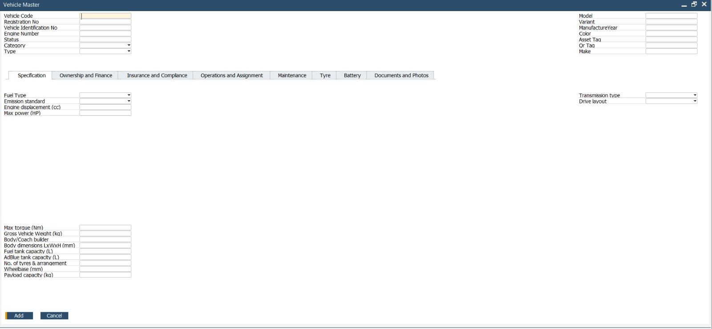

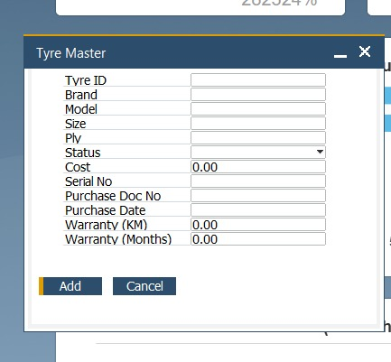

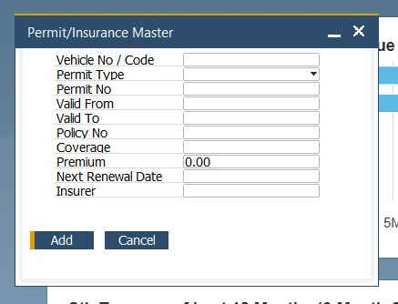

## 02. Trip Management

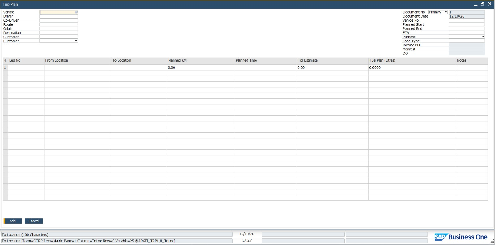

## 03. Fuel Management

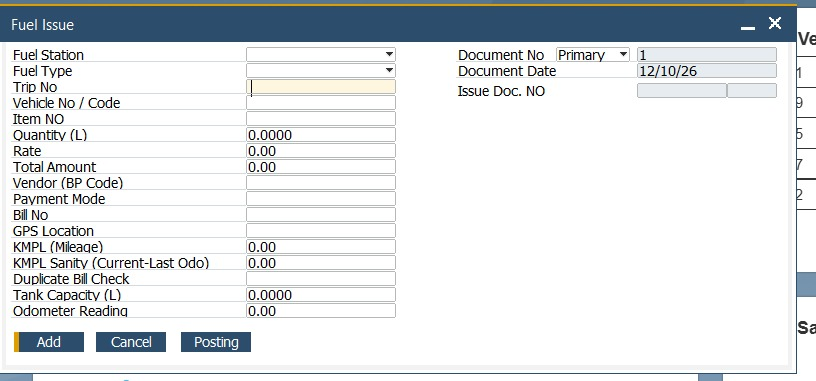

## 04. Maintenance and Workshop

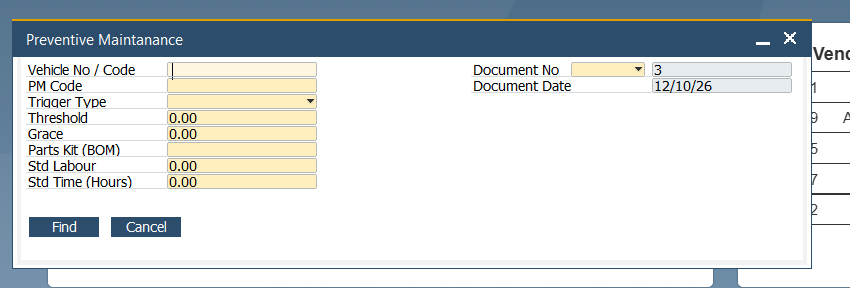

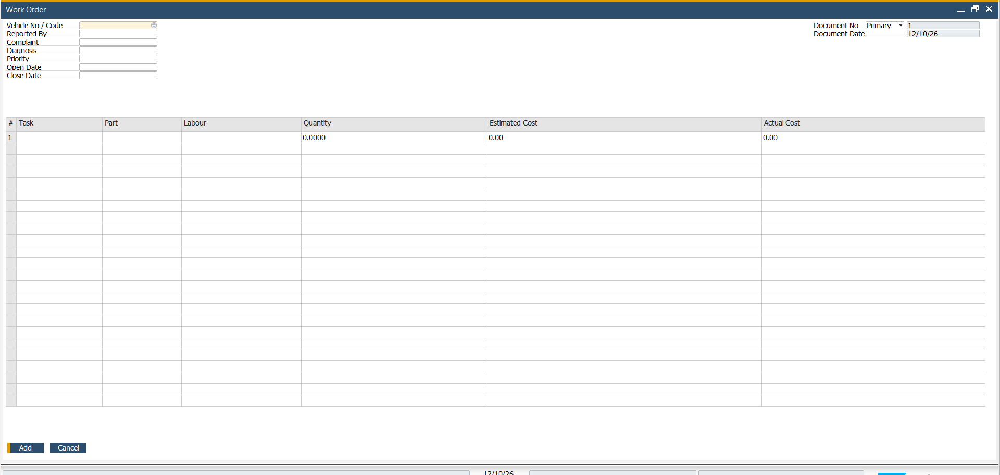

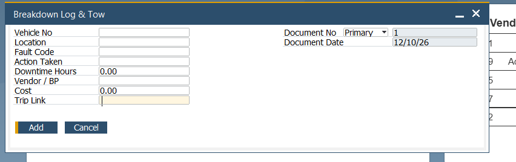

## 05. Tyre Lifecycle

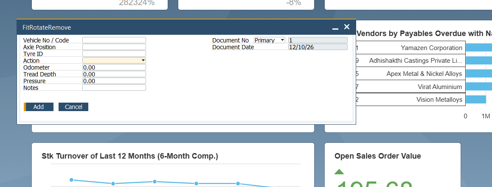

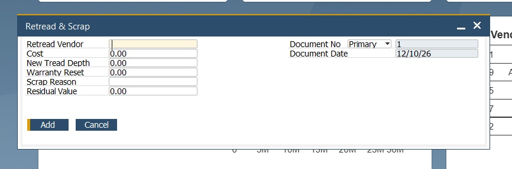

## 06. Compliance and Documents

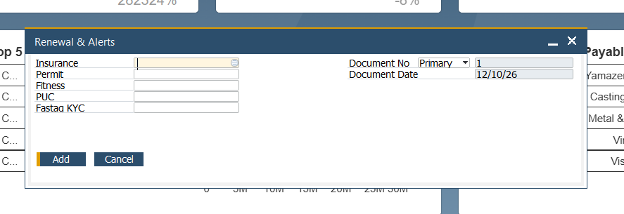

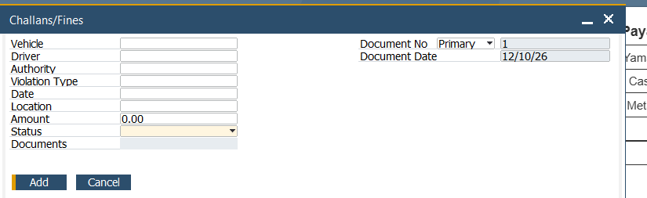

## Portfolio note

Add a short description of the business objective, key user actions, validations and SAP B1 integration for each area. Do not claim functionality that is not implemented.
