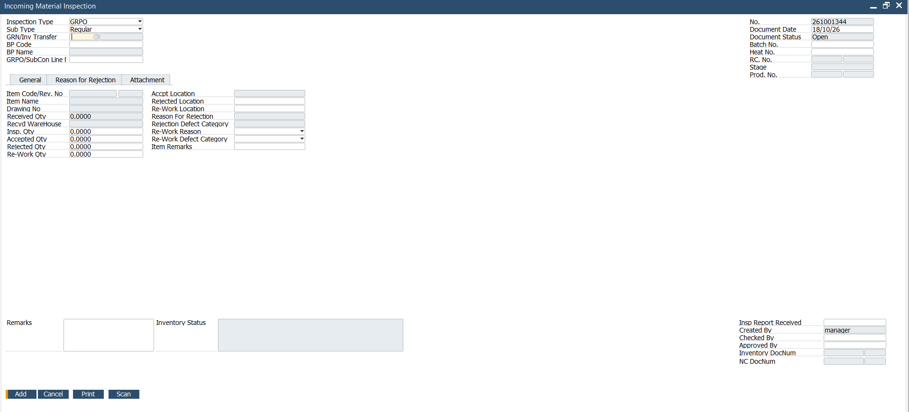
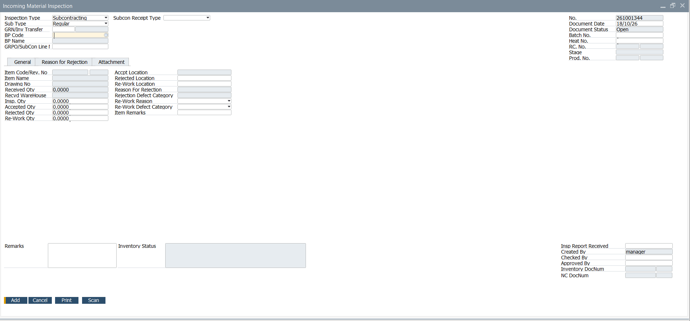
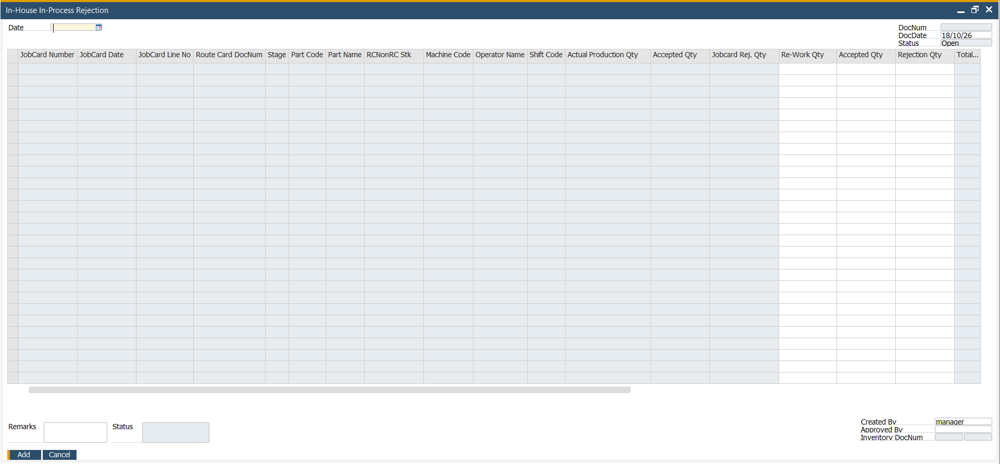
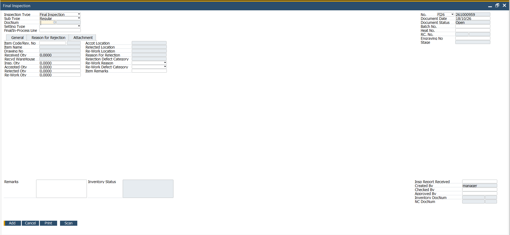
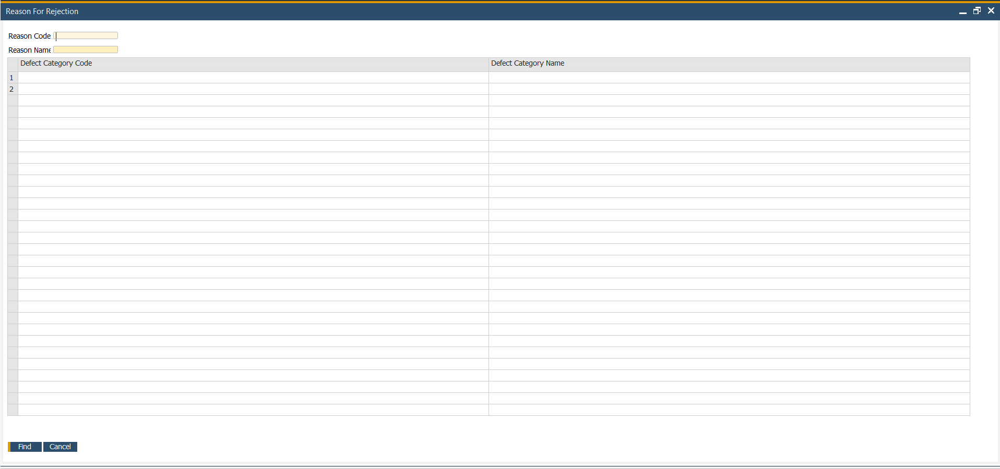
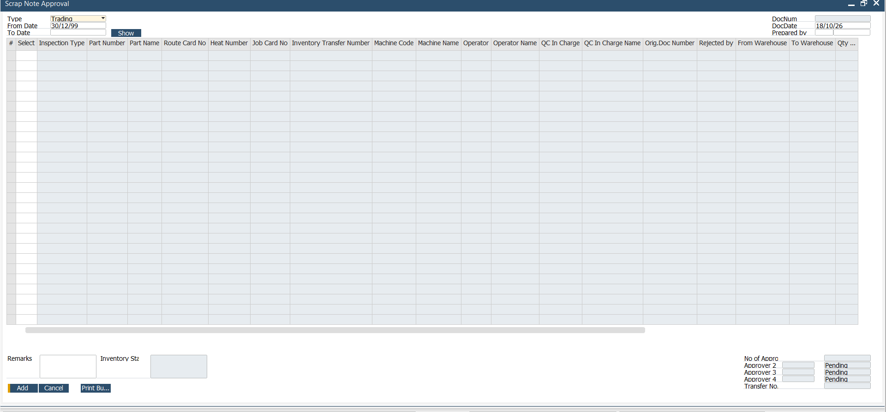

# Quality Add-on

Screenshots of quality-related screens represented in this portfolio.

## Screenshots

## Portfolio note

Explain the inspection stages, rejection handling, approval steps and relevant SAP B1 documents. Include only the workflows that are actually implemented.
